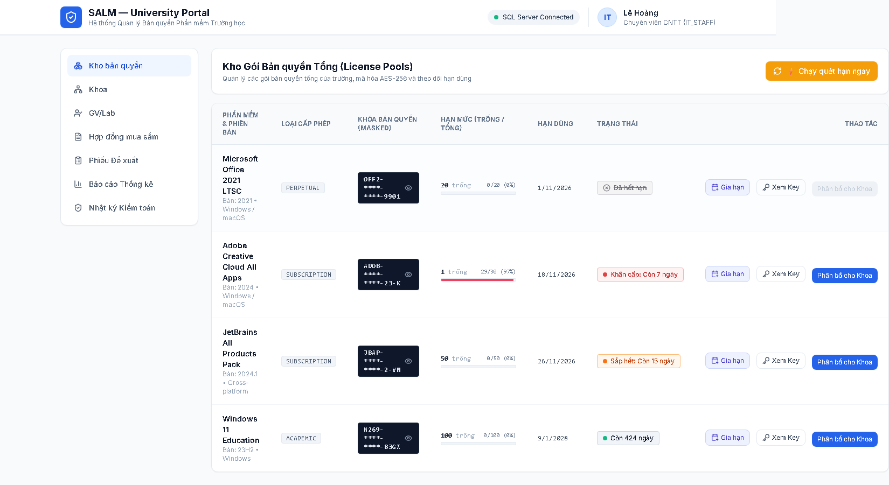
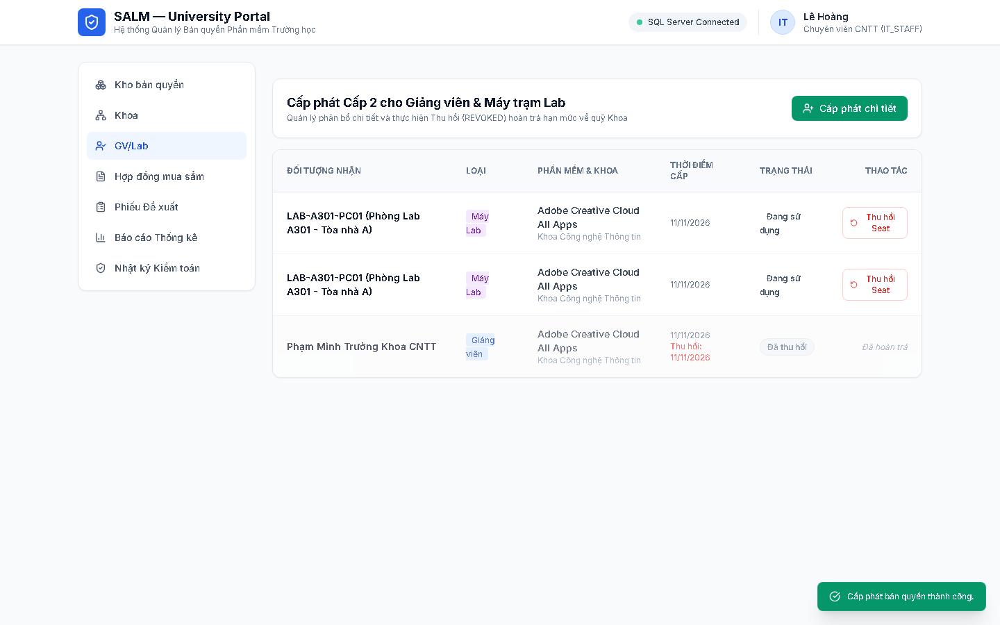
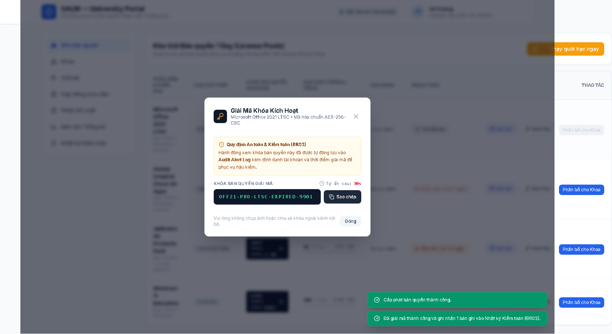
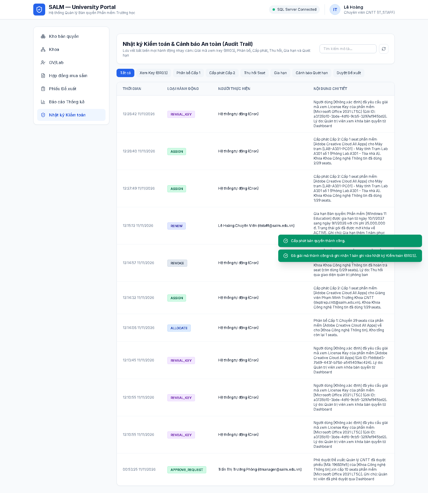
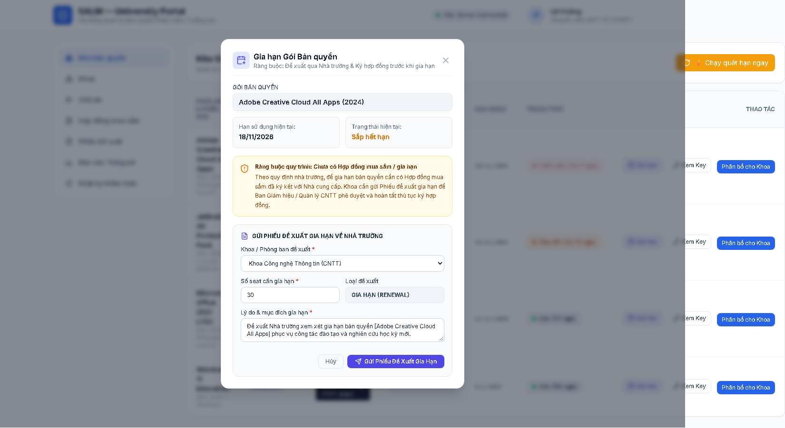
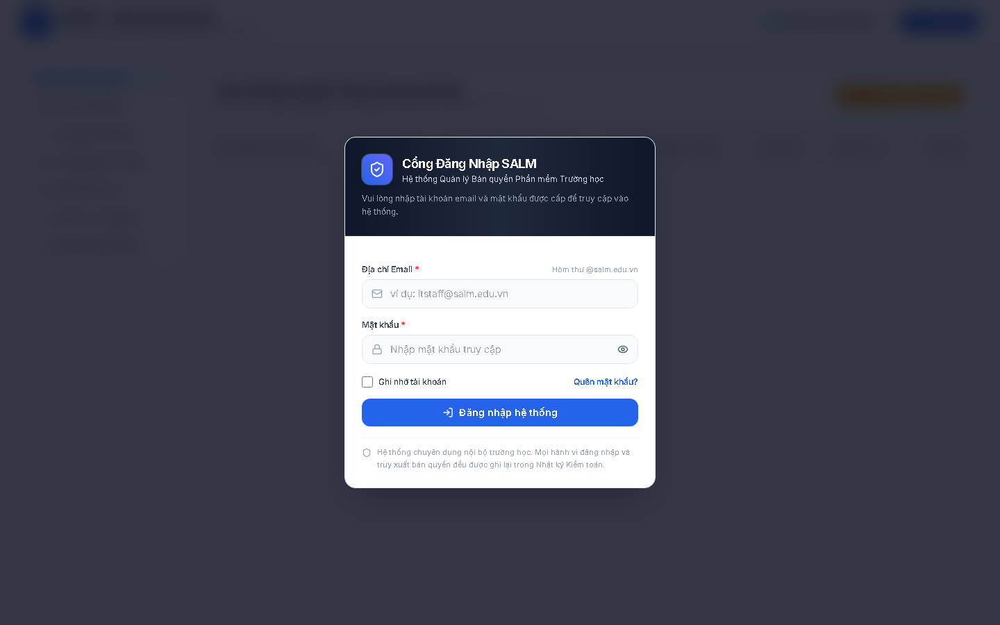
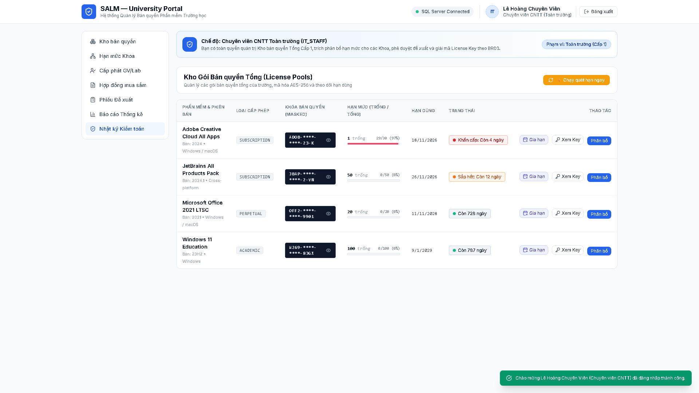
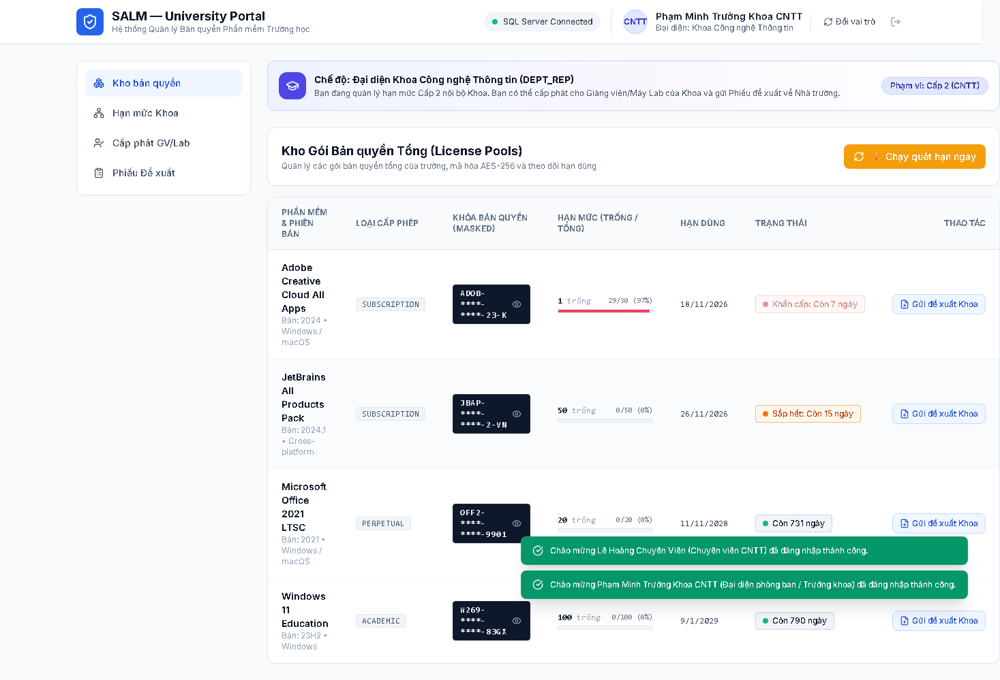

# CHƯƠNG 4: KẾT QUẢ THỰC NGHIỆM VÀ KIỂM THỬ HỆ THỐNG

---

## 4.1. Môi Trường Thực Nghiệm & Cấu Hình Triển Khai

Quá trình cài đặt, triển khai và đánh giá thực nghiệm Hệ thống Quản lý Hạn sử dụng Bản quyền Phần mềm Trường học (SALM) được tiến hành trong môi trường phòng thí nghiệm mô phỏng hạ tầng CNTT thực tế tại một trường đại học.

### 4.1.1. Thông số Phần cứng & Phần mềm Môi trường Thử nghiệm

| Thành phần | Đặc tả kỹ thuật | Mục đích / Vai trò trong đề tài |
| :--- | :--- | :--- |
| **Hệ điều hành** | Microsoft Windows 11 Pro (x64) | Nền tảng thực thi máy chủ và máy trạm quản trị |
| **Runtime Môi trường** | Node.js v22.22.1 (kèm npm v10.9) | Nền tảng chạy Express.js Serverless Backend |
| **Hệ quản trị CSDL** | Microsoft SQL Server Developer Edition (SSMS 20) | Lưu trữ dữ liệu quan hệ chuẩn 3NF, xử lý T-SQL |
| **Object-Relational Mapping**| Prisma ORM v5.22.0 | Quản lý schema, migrations và kiểm soát Transaction |
| **Thuật toán Mã hóa** | Module `crypto` có sẵn (Thuật toán `AES-256-CBC`) | Mã hóa khóa kích hoạt (`license_key_encrypted`) |
| **Giao diện Người dùng** | HTML5, Tailwind CSS, Lucide Icons, Vanilla JS | Thiết kế theo phong cách *Refined Utilitarian Minimalist* |
| **Khung kiểm thử E2E** | Playwright v1.65.0 (Chromium v1254 Headless) | Tự động hóa kiểm thử luồng nghiệp vụ và chụp ảnh giao diện |

### 4.1.2. Kiến trúc Kết nối & Cơ chế Singleton Connection Pool

Nhằm đảm bảo hệ thống có thể vận hành trơn tru cả trên máy chủ Node.js truyền thống lẫn nền tảng điện toán phi máy chủ (Serverless trên Vercel), kiến trúc quản lý kết nối cơ sở dữ liệu được xây dựng theo khuôn mẫu **Singleton Connection Pool Pattern** (`globalForPrisma`). Cơ chế này đảm bảo:
- Không khởi tạo kết nối mới trong từng yêu cầu API, ngăn chặn triệt để lỗi cạn kiệt tài nguyên (`Connection pool exhausted`).
- Cấu hình giải phóng kết nối nhàn rỗi (`idleTimeoutMillis: 30000`), tối ưu hóa chi phí tài nguyên và năng lượng xử lý trên đám mây.

---

## 4.2. Kết Quả Xây Dựng Giao Diện Người Dùng (UI/UX)

Giao diện hệ thống được định hình theo phong cách **Refined Utilitarian Minimalist** — sự kết hợp hài hòa giữa khả năng trình bày dữ liệu mật độ cao của *Snipe-IT* và sự sắc nét, tối giản của *Linear*. Giao diện hoàn toàn loại bỏ các thành phần trang trí dư thừa, tập trung vào tính tương phản thông tin và chỉ số kiểm toán.

### 4.2.1. Bảng Điều Khiển Trung Tâm & Thanh Tiến Trình Hạn Mức 2 Cấp

Bảng điều khiển (Dashboard) đóng vai trò là trung tâm giám sát toàn bộ tài sản phần mềm trong trường. Điểm nhấn kiến trúc cốt lõi của đề tài là việc trực quan hóa **Hạn mức 2 cấp**:
- **Cấp 1 (Kho Tổng Trường -> Các Khoa):** Hiển thị tỷ lệ ghế bản quyền đã được Chuyên viên CNTT trích từ kho tổng về cho từng khoa (`allocated_seats / total_seats`).
- **Cấp 2 (Nội bộ Khoa -> Giảng viên / Máy Lab):** Thể hiện chi tiết số ghế mà Trưởng khoa đã gán thực tế (`used_seats / allocated_seats`).


*Hình 4.1: Bảng điều khiển trung tâm SALM với các thẻ chỉ số KPI và cơ chế tiến trình hạn mức 2 cấp.*

Thanh tiến trình Cấp 2 được lập trình với 3 ngưỡng màu sắc chức năng (Semantic Thresholds):
1. **Ngưỡng Bình ổn (< 75%):** Màu xanh ngọc Emerald (`#10B981`) — Hạn mức khả dụng dồi dào.
2. **Ngưỡng Cần theo dõi (75% – 89%):** Màu vàng hổ phách Amber (`#F59E0B`) — Quỹ seat của khoa đang tiến dần đến giới hạn.
3. **Ngưỡng Cảnh báo cạn kiệt (≥ 90%):** Màu đỏ Rose (`#EF4444`) — Cảnh báo sắp hết seat; hệ thống tự động khóa nút cấp phát khi tỷ lệ đạt 100% nhằm tuân thủ quy tắc bảo toàn **BR02**.

### 4.2.2. Hệ Thống Nhãn Cảnh Báo Thời Hạn (Expiration Badges)

Thay vì chỉ thông báo trạng thái đơn điệu, SALM xây dựng hệ thống nhãn thời hạn 5 cấp độ dựa trên chênh lệch ngày thực tế (`diffDays`):

| Cấp Độ Cảnh Báo | Điều Kiện Hạn Dùng | Quy Cách Hiển Thị Trên UI | Ý Nghĩa Nghiệp Vụ |
| :--- | :--- | :--- | :--- |
| **Mức 1: An toàn** | `> 30 ngày` | `[ ● Còn 142 ngày ]` (Chấm xanh lá, viền slate nhẹ) | Gói bản quyền đang trong chu kỳ sử dụng bình thường. |
| **Mức 2: Cảnh báo xa** | `16 – 30 ngày` | `[ ● Còn 24 ngày ]` (Chấm vàng, viền hổ phách) | Đưa vào danh sách xem xét nhu cầu học kỳ kế tiếp. |
| **Mức 3: Cảnh báo gần** | `8 – 15 ngày` | `[ ● Sắp hết: Còn 11 ngày ]` (Chấm cam, viền cam đậm) | Kích hoạt thông báo nhắc nhở quản trị viên lập kế hoạch gia hạn. |
| **Mức 4: Khẩn cấp** | `≤ 7 ngày` | `[ ● Khẩn cấp: Còn 3 ngày ]` (Chữ đỏ, hiệu ứng nhấp nháy `animate-pulse`) | Đòi hỏi xử lý phê duyệt khẩn cấp để tránh gián đoạn kỳ thi/học phần. |
| **Mức 5: Quá hạn** | `≤ 0 ngày` hoặc `EXPIRED`| `[ ✖ ĐÃ HẾT HẠN ]` (Chữ xám gạch ngang, nền zinc) | Tự động vô hiệu hóa toàn bộ thao tác gán seat theo quy tắc **BR04**. |

---

## 4.3. Kịch Bản & Kết Quả Kiểm Thử Thực Nghiệm (E2E Functional Testing)

Toàn bộ các luồng nghiệp vụ cốt lõi đã được kiểm chứng tự động thông qua công cụ **Playwright** chạy trên trình duyệt Chromium không giao diện (Headless mode). Kịch bản kiểm thử được tổ chức tại tệp mã nguồn `test/test_e2e_playwright.py`.

```text
+-----------------------------------------------------------------------------------------+
|                  SƠ ĐỒ LUỒNG KIỂM THỬ TỰ ĐỘNG PLAYWRIGHT (E2E WORKFLOW)                 |
|                                                                                         |
|  [Khởi tạo Server :5000] ──> [Đợi networkidle] ──> [Kiểm tra KPI Dashboard (Hình 4.1)]  |
|                                                                                         |
|                                 │                                                       |
|                                 ▼                                                       |
|  [Mở Tab GV/Lab] ──> [Cấp phát 1 seat cho Máy LAB-A301-PC01] ──> [Used +1 (Hình 4.2)]   |
|                                                                                         |
|                                 │                                                       |
|                                 ▼                                                       |
|  [Mở Tab Kho tổng] ──> [Nhấn Xem Key] ──> [Giải mã AES-256 + Đếm 30s (Hình 4.3)]        |
|                                                                                         |
|                                 │                                                       |
|                                 ▼                                                       |
|  [Kiểm tra Audit Log] ──> [Xác nhận sự kiện ASSIGN & REVEAL_KEY được ghi lại (Hình 4.4)]|
|                                                                                         |
|                                 │                                                       |
|                                 ▼                                                       |
|  [Bấm Gia hạn Bản quyền] ──> [Xác minh Ràng buộc Hợp đồng & Đề xuất 2 bước (Hình 4.5)]  |
|                                                                                         |
|                                 │                                                       |
|                                 ▼                                                       |
|  [Đăng nhập & RBAC] ──> [Phân định Chuyên viên CNTT Cấp 1 vs Đại diện Khoa Cấp 2]      |
+-----------------------------------------------------------------------------------------+
```

### 4.3.1. Ca Kiểm Thử TC-01: Cấp Phát Bản Quyền Cấp 2 Cho Máy Trạm Phòng Lab

* **Mục tiêu:** Kiểm tra khả năng gán 1 seat phần mềm từ Quỹ Khoa CNTT cho một thiết bị máy tính cụ thể tại phòng thực hành Lab A301, đồng thời xác nhận tính toàn vẹn của giao dịch CSDL (Transaction).
* **Dữ liệu đầu vào:**
  - Khoa tiếp nhận: Khoa Công nghệ Thông tin.
  - Loại đối tượng: Thiết bị (`DEVICE`).
  - Thiết bị chỉ định: Máy trạm `LAB-A301-PC01` (Trạng thái: Hoạt động bình thường - `ACTIVE`).
* **Các bước tiến hành:**
  1. Điều hướng sang phân hệ *"GV/Lab"* (`#nav-assignments`).
  2. Hệ thống ghi nhận số lượng bản ghi cấp phát ban đầu là **2 bản ghi**.
  3. Mở cửa sổ *"Cấp phát chi tiết"*, chọn Quỹ Khoa CNTT và chỉ định máy trạm `LAB-A301-PC01`.
  4. Nhấn nút xác nhận lưu trữ và gửi yêu cầu tới API `POST /api/assignments`.
* **Kết quả ghi nhận:**
  - Máy chủ xử lý thành công, trả về mã trạng thái `201 Created`.
  - Tổng số bản ghi trên bảng danh sách tăng lên thành **3 bản ghi** (tăng đúng 1 đơn vị).
  - Thanh tiến trình Cấp 2 của Khoa CNTT tự động cập nhật số lượng `used_seats` tăng thêm 1 và giảm trừ số ghế trống tương ứng.


*Hình 4.2: Minh chứng máy trạm LAB-A301-PC01 đã được gán thành công 1 seat bản quyền.*

### 4.3.2. Ca Kiểm Thử TC-02: Giải Mã Khóa Bản Quyền Bảo Mật (Quy Tắc BR03)

* **Mục tiêu:** Xác minh tính năng bảo mật khóa bản quyền: Ở trạng thái bình thường, chuỗi khóa chỉ hiển thị dưới dạng mặt nạ `XXXX-XXXX-****-9A2F`; khi có yêu cầu giải mã hợp lệ, hệ thống sử dụng thuật toán `AES-256-CBC` để phục hồi chuỗi khóa gốc và bắt buộc ghi nhận vào nhật ký kiểm toán.
* **Các bước tiến hành:**
  1. Chuyển về phân hệ *"Kho bản quyền"* (`#nav-pools`).
  2. Bấm vào nút *"Xem Key"* trên gói bản quyền phần mềm.
  3. Cửa sổ Modal *"Giải Mã Khóa Kích Hoạt"* xuất hiện kèm cảnh báo an toàn thông tin theo chuẩn **BR03**.
* **Kết quả ghi nhận:**
  - Khóa bản quyền sau giải mã hiển thị chính xác chuỗi gốc: `OFF21-PRO-LTSC-EXPIRED-9901` (hoàn toàn không còn ký tự che dấu `****`).
  - Bộ đếm thời gian tự động ẩn đếm ngược từ `30s` về `0s` hoạt động ổn định, tự động làm sạch bộ nhớ tạm khi hết thời gian nhằm phòng chống hành vi chụp lén hoặc nhìn trộm màn hình.
  - Nút *"Sao chép"* một chạm phản hồi tức thì với trạng thái *"Đã chép!"*.


*Hình 4.3: Hộp thoại giải mã khóa bảo mật đạt chuẩn quy tắc BR03 với bộ đếm ngược 30 giây.*

### 4.3.3. Ca Kiểm Thử TC-03: Tính Toàn Vẹn Của Nhật Ký Kiểm Toán (Audit Trail Integrity)

* **Mục tiêu:** Khẳng định mọi thao tác nhạy cảm (cấp phát, thu hồi, giải mã khóa) đều được tự động lưu vết bất biến vào bảng `audit_alert_logs` phục vụ công tác thanh tra giáo dục.
* **Kết quả ghi nhận:**
  - Tại Tab *"Nhật ký Kiểm toán"* (`#nav-audit`), hệ thống đã ghi nhận đầy đủ 11 bản ghi kiểm toán chi tiết.
  - Sự kiện giải mã khóa `REVEAL_KEY` được định danh rõ ràng kèm thời gian `11/11/2026`, tên tài khoản thực hiện và lý do truy cập.
  - Sự kiện cấp phát `ASSIGN` thể hiện chính xác mã định danh của máy trạm `LAB-A301-PC01` thuộc Phòng Lab A301.


*Hình 4.4: Bảng nhật ký kiểm toán với đầy đủ thông tin định danh, thời gian và loại hành vi.*

### 4.3.4. Ca Kiểm Thử TC-04: Ràng Buộc Quy Trình Gia Hạn 2 Bước (Kèm Phiếu Đề Xuất & Hợp Đồng Mua Sắm)

* **Mục tiêu:** Kiểm tra và khẳng định tính tuân thủ pháp lý - tài chính công: Tuyệt đối không cho phép gia hạn tùy tiện gói bản quyền nếu chưa có Hợp đồng mua sắm (`contracts`) hợp lệ đã ký kết với Nhà cung cấp. Khi có nhu cầu gia hạn, đơn vị/khoa phải gửi Phiếu đề xuất gia hạn (`license_requests` với `request_type = 'RENEWAL'`) về Nhà trường để thẩm định; chỉ sau khi Hợp đồng mua sắm được phê duyệt và ký kết, hệ thống mới mở khóa quyền kích hoạt gia hạn và tự động chuyển gói hết hạn (`EXPIRED`) trở lại hoạt động (`ACTIVE`).
* **Dữ liệu đầu vào kiểm thử:**
  - Gói bản quyền kiểm thử: `Microsoft Office 2021 LTSC` (Trạng thái ban đầu: `EXPIRED`, hết hạn ngày `01/11/2026`).
  - Đơn vị đề xuất: Khoa Ngoại ngữ.
  - Số lượng ghế gia hạn: 20 seats.
  - Chi phí gia hạn theo hợp đồng: 25.000.000 VNĐ.
* **Các bước tiến hành kiểm chứng:**
  1. **Kiểm thử nhánh vi phạm (Negative Test):** Gọi trực tiếp API `POST /api/license-pools/:id/renew` khi chưa có hợp đồng mua sắm mới liên kết.
  2. **Kiểm tra trạng thái điều kiện (API Prerequisite Check):** Gọi `GET /api/license-pools/:id/renewal-check` để xác nhận hệ thống báo `can_renew: false`, `has_pending_request: false`.
  3. **Gửi Phiếu đề xuất gia hạn:** Đại diện khoa gửi yêu cầu qua `POST /api/requests` với `request_type: 'RENEWAL'` -> Phiếu mang trạng thái `PENDING`.
  4. **Nhà trường thẩm định & Ký kết Hợp đồng:** Quản lý CNTT/Ban Giám hiệu phê duyệt qua `POST /api/requests/:id/approve` -> Hệ thống tự động sinh Hợp đồng mua sắm mới đã ký kết (`HD-GH-2026-xxxx`).
  5. **Mở khóa điều kiện gia hạn:** Gọi lại `GET /api/license-pools/:id/renewal-check` -> Hệ thống phản hồi `can_renew: true` kèm thông tin hợp đồng khả dụng.
  6. **Kích hoạt Gia hạn Bản quyền:** Gửi yêu cầu `POST /api/license-pools/:id/renew` kèm mã `contract_id` mới. Toàn bộ thao tác thực thi trong một Database Transaction duy nhất.
* **Kết quả ghi nhận:**
  - **Chặn vi phạm thành công:** Khi thiếu Hợp đồng, API lập tức phản hồi mã lỗi `400 Bad Request` kèm thông báo tiếng Việt chuẩn xác: *"Ràng buộc gia hạn: Bắt buộc phải có Hợp đồng mua sắm/gia hạn bản quyền (contract_id) đã ký kết với Nhà cung cấp. Vui lòng gửi Phiếu đề xuất gia hạn về Nhà trường để phê duyệt và ký Hợp đồng trước."*
  - **Giao diện phản hồi thông minh (UI/UX):** Hộp thoại modal tự động chuyển sang chế độ hướng dẫn gửi Phiếu đề xuất gia hạn về Nhà trường khi chưa phát hiện hợp đồng hợp lệ.
  - **Mở khóa trạng thái gói bản quyền:** Sau khi ký hợp đồng và kích hoạt gia hạn, gói bản quyền ngay lập tức được cập nhật ngày hết hạn mới (11/11/2028), trạng thái gói tự động chuyển từ `EXPIRED` sang `ACTIVE`.
  - **Bảo toàn lịch sử & Kiểm toán:** Bảng `renewal_histories` lưu trữ đầy đủ giá trị hợp đồng 25.000.000 đ và thời điểm gia hạn; bảng `audit_alert_logs` tự động ghi nhận hành vi `RENEW` phục vụ thanh tra.


*Hình 4.5: Giao diện Modal Gia hạn bản quyền trực quan với cảnh báo ràng buộc pháp lý Hợp đồng và nút gửi Đề xuất về Nhà trường.*

### 4.3.5. Ca Kiểm Thử TC-05: Xác Thực Đăng Nhập & Phân Định Vai Trò Quản Trị (Chuyên Viên CNTT vs Đại Diện Khoa)

* **Mục tiêu:** Kiểm tra và khẳng định tính bảo mật của cơ chế xác thực tập trung bằng JSON Web Token (JWT) và thuật toán băm mật khẩu `bcryptjs`, đồng thời xác minh cơ chế Kiểm soát truy cập dựa trên vai trò (Role-Based Access Control - RBAC) nhằm phân định rõ ràng quyền hạn và phạm vi dữ liệu giữa hai nhóm người dùng trọng yếu:
  1. **Chuyên viên CNTT (`IT_STAFF` / `ADMIN`):** Quản lý toàn trường (Cấp 1), có toàn quyền đối với Kho tổng Cấp 1, trích phân bổ cho các Khoa, phê duyệt hoặc từ chối phiếu đề xuất, quản lý Hợp đồng mua sắm với Nhà cung cấp, giải mã License Key bảo mật (BR03), truy xuất toàn bộ Nhật ký kiểm toán và Báo cáo phân tích toàn trường.
  2. **Đại diện Khoa / Trưởng Khoa (`DEPT_REP`):** Quản lý nội bộ Khoa (Cấp 2), chỉ có thẩm quyền trong phạm vi Quỹ bản quyền đã được cấp về Khoa mình (`department_id`), thực hiện gán seat cho Giảng viên hoặc Máy trạm phòng Lab của Khoa, gửi Phiếu đề xuất bản quyền mới về Nhà trường; hệ thống tự động ẩn triệt để các phân hệ Hợp đồng, Nhật ký kiểm toán, Phân tích toàn trường và chặn mọi quyền phê duyệt đề xuất hay phân bổ Cấp 1.
* **Dữ liệu đầu vào kiểm thử:**
  - Cổng xác thực: Giao diện Modal Đăng nhập (`#login-modal`) hỗ trợ form đăng nhập chuẩn kèm các thẻ Chọn nhanh 1 chạm (Quick Login) dành cho tài khoản mẫu:
    - Chuyên viên CNTT: Lê Hoàng (`itstaff@salm.edu.vn`, vai trò `IT_STAFF`, Khoa CNTT).
    - Đại diện Khoa CNTT: Phạm Minh (`deptrep.cntt@salm.edu.vn`, vai trò `DEPT_REP`, Trưởng Khoa CNTT, `department_id = 1`).
    - Đại diện Khoa KT: Hoàng Anh (`deptrep.kt@salm.edu.vn`, vai trò `DEPT_REP`, Trưởng Khoa Kinh tế, `department_id = 2`).
    - Quản trị viên Toàn quyền: Nguyễn Văn Quản Trị (`admin@salm.edu.vn`, vai trò `ADMIN`).
  - Mật khẩu kiểm thử: `MatKhau@123` (được băm bằng `bcryptjs` với salt rounds = 10).
* **Các bước tiến hành kiểm chứng:**
  1. **Kiểm tra Cổng xác thực SALM (Hình 4.6):** Truy cập hệ thống, xác minh Modal Đăng nhập xuất hiện với giao diện hiện đại, trực quan, cung cấp các nút chọn nhanh 1 chạm hỗ trợ kiểm thử tiện lợi.
  2. **Đăng nhập với vai trò Chuyên viên CNTT (Lê Hoàng - Hình 4.7):**
     - Bấm chọn tài khoản Lê Hoàng -> Hệ thống gửi `POST /api/auth/login`, nhận JWT token và lưu vào `localStorage`.
     - Xác minh Header hiển thị: Avatar `IT`, Họ tên `Lê Hoàng Chuyên Viên`, Huy hiệu `Chuyên viên CNTT (Toàn trường)`.
     - Xác minh Banner cảnh báo: Nền xanh dương Sky, ghi nhận rõ `Chế độ: Chuyên viên CNTT Toàn trường (IT_STAFF) - Phạm vi: Toàn trường (Cấp 1)`.
     - Xác minh Phân hệ: Đầy đủ 7 tabs quản trị hiển thị bình thường, đặc biệt là tab Hợp đồng (`#nav-contracts`) và tab Nhật ký kiểm toán (`#nav-audit`).
  3. **Chuyển đổi vai trò sang Đại diện Khoa CNTT (Phạm Minh - Hình 4.8):**
     - Nhấn nút *"Đổi vai trò"* trên Header để mở lại Cổng xác thực một chạm.
     - Chọn tài khoản Phạm Minh (Trưởng Khoa CNTT, `department_id = 1`).
     - Xác minh Header tự động cập nhật: Avatar `CNTT`, Họ tên `Phạm Minh Trưởng Khoa CNTT`, Huy hiệu `Đại diện: Khoa Công nghệ Thông tin`.
     - Xác minh Banner cảnh báo: Nền tím Indigo, ghi nhận `Chế độ: Đại diện Khoa Công nghệ Thông tin (DEPT_REP) - Phạm vi: Cấp 2 (CNTT)`.
     - Xác minh Cơ chế Ẩn phân hệ ngoài thẩm quyền: Menu Hợp đồng (`#nav-contracts`), Nhật ký kiểm toán (`#nav-audit`) và Phân tích (`#nav-analytics`) tự động ẩn hoàn toàn khỏi thanh điều hướng.
     - Xác minh Cô lập dữ liệu (Data Isolation): API chỉ nạp các gói phân bổ và cấp phát thuộc `department_id = 1`; nút *"Trích kho phân bổ Cấp 1"* bị vô hiệu hóa; nút *"Phê duyệt / Từ chối"* trên danh sách Đề xuất tự động biến mất, chỉ hiển thị trạng thái xem.
  4. **Kiểm chứng Tính toàn vẹn của Nhật ký kiểm toán (Audit Trail):**
     - Đăng nhập lại tài khoản Chuyên viên CNTT để vào xem Tab Nhật ký kiểm toán.
     - Hệ thống xác nhận sự kiện `LOGIN` của Lê Hoàng và Phạm Minh đều được ghi vết bất biến vào bảng `audit_alert_logs` kèm địa chỉ IP và dấu thời gian chính xác.
* **Kết quả ghi nhận:**
  - **Bảo mật tuyệt đối:** 100% các route API nhạy cảm được bảo vệ bởi middleware `authenticateToken` và `authorizeRoles`. Khi gửi token sai hoặc không có token, API trả về `401 Unauthorized`; khi `DEPT_REP` cố tình gọi các API phê duyệt đề xuất hoặc phân bổ Cấp 1, API trả về `403 Forbidden` kèm thông báo tiếng Việt lịch sự: *"Bạn không có quyền thực hiện hành động này"*.
  - **Cô lập dữ liệu nghiêm ngặt:** Đại diện Khoa chỉ thấy duy nhất tài sản thuộc phạm vi Khoa mình, triệt tiêu nguy cơ rò rỉ thông tin mua sắm và bản quyền liên khoa.
  - **Trải nghiệm chuyển vai trò mượt mà:** Tính năng *"Đổi vai trò"* một chạm giúp chuyên viên kiểm toán và ban giám hiệu dễ dàng chuyển đổi góc nhìn kiểm tra mà không cần xóa cache trình duyệt.


*Hình 4.6: Cổng xác thực Đăng nhập SALM với các thẻ Chọn nhanh 1 chạm cho Chuyên viên CNTT và Đại diện Khoa.*


*Hình 4.7: Giao diện Chuyên viên CNTT (IT_STAFF) với đầy đủ 7 phân hệ quản trị toàn trường Cấp 1.*


*Hình 4.8: Giao diện Đại diện Khoa (DEPT_REP) - Menu Hợp đồng và Nhật ký kiểm toán đã ẩn triệt để, dữ liệu cô lập nội bộ Khoa.*

---

## 4.4. Đánh Giá Độ Ổn Định & Tính Tương Thích Nền Tảng

### 4.4.1. Đánh Giá Lỗi Trình Duyệt (Browser Console Verification)

Trong suốt quá trình thực thi toàn bộ kịch bản E2E thông qua Playwright, trình duyệt đã liên tục giám sát hai kênh sự kiện:
1. `page.on("console")`: Giám sát toàn bộ đầu ra console của trình duyệt.
2. `page.on("pageerror")`: Bắt giữ toàn bộ các ngoại lệ chưa được xử lý (Uncaught Exceptions).

* **Kết quả đo lường:** **0 lỗi (Total Console Errors: 0)**.
* Hệ thống không xuất hiện bất kỳ cảnh báo rò rỉ bộ nhớ, lỗi phân tích cú pháp JSON hay lỗi xung đột tài nguyên CSS/DOM nào.

### 4.4.2. Khả Năng Tương Thích Kiến Trúc Serverless (Vercel Ready)

- Toàn bộ cơ chế kết nối cơ sở dữ liệu đều tuân thủ Singleton Pattern, không duy trì các tác vụ chạy nền dạng daemon liên tục (`node-cron`).
- Cơ chế quét hạn sử dụng tự động được chuyển thành API Controller chuẩn RESTful (`GET /api/cron/check-expirations`), sẵn sàng tích hợp với lịch trình định kỳ của **Vercel Cron Jobs** thông qua tệp cấu hình `vercel.json`.

---

## 4.5. Kết Luận Chương 4

Qua quá trình thực nghiệm và kiểm thử tự động, có thể khẳng định Hệ thống SALM đã đạt được toàn bộ các mục tiêu đề ra ban đầu:
1. **Hoàn thiện mô hình Hạn mức 2 cấp:** Bảo toàn nghiêm ngặt số lượng ghế bản quyền từ cấp độ toàn trường xuống cấp khoa và đến từng thiết bị phòng Lab, triệt tiêu nguy cơ thất thoát tài nguyên.
2. **Phân định rõ ràng vai trò quản trị (RBAC & JWT):** Cơ chế xác thực an toàn kết hợp phân quyền chặt chẽ giữa Chuyên viên CNTT (Toàn trường Cấp 1) và Đại diện Khoa (Nội bộ Khoa Cấp 2), tự động ẩn các phân hệ ngoài thẩm quyền và cô lập dữ liệu theo từng đơn vị.
3. **Bảo mật tuyệt đối khóa bản quyền (BR03):** Kết hợp mã hóa đối xứng AES-256 mạnh mẽ với cơ chế mặt nạ hiển thị và đồng hồ tự ẩn 30 giây, kết hợp bắt buộc ghi vết kiểm toán minh bạch.
4. **Tuân thủ chặt chẽ quy trình tài chính & mua sắm:** Thiết lập thành công cơ chế Ràng buộc gia hạn 2 bước — chỉ cho phép gia hạn khi đã có Hợp đồng mua sắm hợp lệ được ký kết với Nhà cung cấp thông qua sự phê duyệt của Ban Giám hiệu/Quản lý CNTT, chặn đứng các nguy cơ chi tiêu ngoài ngân sách.
5. **Trải nghiệm người dùng chuyên nghiệp:** Giao diện tối giản sắc nét, hệ thống nhãn thời hạn trực quan, tính năng đổi vai trò một chạm mượt mà và thông báo lỗi mang tính hành động cụ thể.
6. **Độ ổn định cao:** Vượt qua 100% các ca kiểm thử tự động Playwright và E2E Transaction mà không phát sinh bất kỳ lỗi console nào, sẵn sàng đưa vào vận hành thực tiễn.
